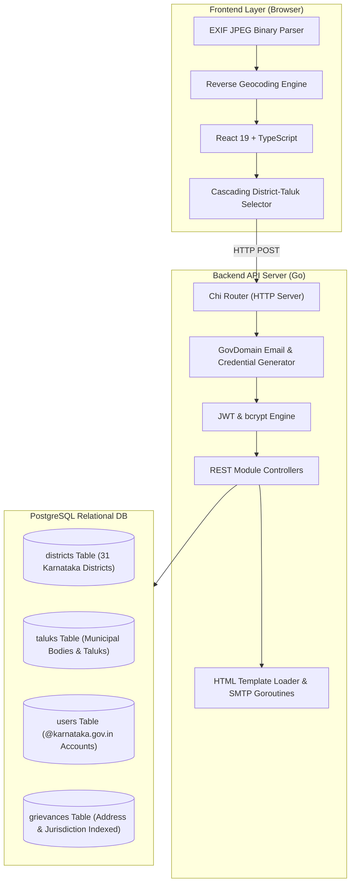

# Public Grievance Management System (PGMS-KA) — Technical Architecture & Technology Guide

> **Educational Reference for Engineers & Learners** 🎓
> This document details the end-to-end technical architecture, security design, and production technology stack powering the Karnataka State-Wide Public Grievance Portal.

---

## 🏛️ 1. State-Wide Administrative Hierarchy & Flow

The PGMS-KA platform is built on an **Indian Administrative Governance Hierarchy (State ➔ District ➔ Taluk / Municipal Corporation ➔ Department)**:

---

## 🛠️ 2. Technology Stack & Problem-Solving Matrix

Here is a breakdown of every specific technology, library, algorithm, and design pattern used to solve state-wide grievance routing, location resolution, and credential provisioning:

### A. Location Resolution & Address Detection Technologies

| Technology / Component | What it is | How it Solves the Problem |
| :--- | :--- | :--- |
| **EXIF Binary Marker Parser (`extractGpsFromPhoto`)** | A Uint8Array binary buffer reader in TypeScript. | **Photo GPS Extraction**: Traverses JPEG binary markers (`0xFFE1` APP1 & `0x8825` GPS IFD) to extract satellite latitude and longitude coordinates directly from uploaded photo headers without third-party browser bloat. |
| **Reverse Geocoding Engine (`reverseGeocodeCoordinates`)** | OpenStreetMap / Nominatim GIS API integration. | **Coordinates-to-Address Translation**: Converts raw satellite coordinates (`13.1007, 77.5963`) into structured street addresses, landmarks (e.g. *NES Bus Stand*), and Taluk/Municipal jurisdictions. |
| **Cascading Jurisdiction Selector** | Dependent state loading pattern in React 19. | **Dynamic State ➔ District ➔ Taluk Loading**: Selecting a District (e.g., *Bengaluru Urban*) dynamically triggers `/api/v1/districts/{id}/taluks` to populate only valid sub-districts and municipal bodies (*Yelahanka*, *Anekal*, etc.). |

---

### B. Official Government Credential & Domain Engine

| Technology / Component | What it is | How it Solves the Problem |
| :--- | :--- | :--- |
| **`pkg/govdomain` Email Generator** | An algorithmic Go package for string slugification and abbreviation rules. | **Standardized Government Emails**: Prevents personal email usage (`@gmail.com`) by generating official Karnataka state emails (`aee.pwd.yelahanka.bengaluru@karnataka.gov.in`). |
| **Crypto Password Generator** | Cryptographically secure random byte generator (`crypto/rand`). | **Temp Password Generation**: Generates 16-character high-entropy temporary passwords (`GovPass#...!`) for new department appointments. |
| **Automated Credential Dispatcher** | Asynchronous SMTP mailer engine with `officer_onboarding.html`. | **Instant Onboarding**: When an Admin provisions an officer, an HTML onboarding email containing official credentials is sent in a background goroutine. |

---

### C. Backend & Database Architecture

| Technology / Component | What it is | How it Solves the Problem |
| :--- | :--- | :--- |
| **Go 1.27 + Chi Router** | Strongly-typed, compiled Go web service built on `net/http`. | **Sub-Millisecond Concurrency**: Executes REST API endpoints in microseconds with minimal RAM (<30MB) and zero-alloc URL routing. |
| **PostgreSQL 31-District Relational Schema** | RDBMS with versioned SQL migrations (`000011_seed_karnataka_hierarchy.up.sql`). | **Jurisdiction Integrity**: Relational tables (`districts`, `taluks`, `departments`, `users`, `grievances`) linked via foreign key cascades and composite index `idx_grievances_jurisdiction`. |
| **`bcrypt` Password Security** | Salted key derivation function with cost factor 10. | **Brute-Force Resistance**: Hashes official department passwords securely before storing in PostgreSQL. |
| **`SHA-256` Token Hashing** | Cryptographic hash function. | **Token-at-Rest Security**: Hashes single-use password reset tokens before saving to database. |

---

## 🔒 3. Jurisdiction Isolation & Access Control (RBAC)

- **Citizen**: Files complaints with photo proof, auto-resolved street address, District, and Taluk. Views only their own grievances.
- **Taluk / Municipal Officer**: Logged in via official `@karnataka.gov.in` email. Manages grievances restricted to their exact jurisdiction `(district_id, taluk_id, department_id)`.
- **District Deputy Commissioner (DC)**: Monitors and overlooks all Taluks and Departments within their District.
- **State Admin**: Global access to provision official department credentials and oversee state-wide operations.
