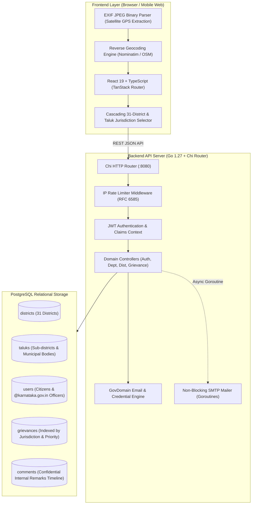

# PGMS-KA: Public Grievance Management System

<p align="center">
  
  
  
  
  
  
  
</p>

<p align="center">
  <strong>An enterprise-grade, state-wide civic grievance redressal and automated jurisdictional routing platform engineered for the 31 districts and administrative divisions of Karnataka.</strong>
</p>

---

## 📌 Executive Summary

In public governance, citizen grievances frequently suffer from jurisdictional ambiguity, lack of photographic verifiable proof, manual routing bottlenecks, and opaque tracking timelines.

**PGMS-KA** is a high-performance, full-stack e-governance platform designed to streamline and automate the entire lifecycle of public grievances. It bridges citizens, taluk officers, district administrators, and state departments through:
- **Client-Side EXIF GPS Satellite Extraction**: Automatically extracts latitude and longitude coordinates from uploaded photo proofs directly in the browser.
- **Automated Reverse Geocoding**: Translates raw GPS satellite coordinates into structured street addresses, landmarks, and administrative boundaries.
- **Hierarchical Jurisdictional Routing**: Automatically matches grievances to their exact administrative jurisdiction (**State → District → Taluk / Municipal Corporation → Department**).
- **Official Government Domain Engine (`pkg/govdomain`)**: Programmatically creates and provisions verified `@karnataka.gov.in` officer email credentials and high-entropy passwords.
- **High-Throughput Concurrent Architecture**: Powered by a compiled Go modular monolith running on Chi Router with non-blocking asynchronous email dispatchers via Goroutines.

---

## 🏛️ System Architecture & Workflow

The platform follows a clean **Modular Monolith Architecture** decoupled into distinct domain boundaries (`auth`, `districts`, `departments`, `grievances`), backed by a relational PostgreSQL schema.



### Visual Architecture & Database Schemas

<p align="center">
  
</p>

<details>
  <summary>🔍 <strong>Click to expand Layered Architecture & Database Entity-Relationship Diagrams</strong></summary>
  <br/>
  
  <p align="center">
    <strong>Layered Architecture Diagram</strong><br/>
    
  </p>
  
  <p align="center">
    <strong>PostgreSQL Database Entity Relationship (ERD)</strong><br/>
    
  </p>
</details>

---

## 🚀 Standout Engineering Highlights

### 1. In-Browser Binary EXIF GPS Extraction
Rather than relying on inaccurate browser location prompts, the frontend features an in-memory binary EXIF parser. When a citizen uploads an on-site photo of a civic issue (e.g., road pothole, broken water main), the app inspects JPEG binary markers (`0xFFE1` APP1 & `0x8825` GPS IFD) to extract satellite latitude/longitude coordinates directly from the camera metadata, preventing fraudulent submissions.

### 2. Autonomous Jurisdictional Resolution
The extracted satellite coordinates are passed to a GIS reverse-geocoding engine that returns street addresses and landmarks. The frontend's cascading selector automatically resolves the complaint to the designated District (e.g., *Bengaluru Urban*) and corresponding Taluk/Corporation (e.g., *Yelahanka*), locking the jurisdiction before dispatching to the backend.

### 3. Automated Government Email Engine (`pkg/govdomain`)
To prevent department officers from using unverified personal emails (`@gmail.com`), the backend includes a domain-specific slugification engine in Go. When an administrative officer is onboarded, the system generates an official standardized address:
```
[Role].[Department].[Taluk].[District]@karnataka.gov.in
Example: aee.pwd.yelahanka.bengaluru@karnataka.gov.in
```
Simultaneously, a 16-character high-entropy temporary password (`crypto/rand`) is generated, hashed with salted `bcrypt` (cost 10), and dispatched directly to the official onboarding email via an HTML template.

### 4. Zero-Latency Asynchronous SMTP Dispatcher
Status update notifications and department assignments are handled via non-blocking Go Goroutines. Instead of holding open client HTTP connections while connecting to external SMTP gateways (`smtp.gmail.com:587`), the API acknowledges requests in **sub-20 milliseconds**, while background workers render HTML templates and deliver notifications concurrently.

### 5. Multi-Tenant Role-Based Access Control (RBAC)
- **Citizen**: Files complaints with geo-tagged images, tracks status timelines, and views self-submitted grievances.
- **Department Officer**: Access strictly quarantined to their specific `(district_id, taluk_id, department_id)` jurisdiction. Access to confidential internal remarks timeline.
- **District Deputy Commissioner (DC)**: Cross-department monitoring of all taluks and municipal bodies within their assigned district.
- **State Super Admin**: State-wide governance, officer credential provisioning, and system-wide audits.

---

## 🛠️ Technology Stack

| Layer | Technology | Purpose / Rationale |
| :--- | :--- | :--- |
| **Backend Language** | **Go (Golang 1.27)** | Strongly-typed, compiled performance with low memory usage (<30MB RAM) and native concurrency. |
| **HTTP Framework** | **Chi Router v5** | Zero-allocation URL routing, 100% compatible with standard `net/http` handlers and idiomatic middleware chaining. |
| **Database** | **PostgreSQL 16** | Relational integrity with foreign key cascades and composite indexes (`idx_grievances_jurisdiction`). |
| **Authentication** | **JWT (Access + Refresh)** | Stateless access tokens with secure `HttpOnly` refresh token rotation and Google OAuth 2.0. |
| **Cryptography** | **bcrypt & SHA-256** | Salted password hashing (cost factor 10) and hashed single-use tokens at rest. |
| **Traffic Control** | **In-Memory Rate Limiter** | Sliding window rate limiter middleware returning RFC 6585 headers (`429 Too Many Requests`). |
| **Frontend Framework** | **React 19 + TypeScript 5.8** | Modern reactive UI built with strict typing and modern component composition. |
| **Routing & State** | **TanStack Router & Query** | Type-safe URL routing and server-state caching with background refetching. |
| **Styling & UI** | **Tailwind CSS v4 + Radix UI** | Modern CSS architecture and unstyled accessible primitives. |
| **Image & OCR** | **ExifReader & Tesseract.js** | Client-side JPEG metadata parsing and optical character recognition for document validation. |

---

## 📂 Project Structure

```
Public_Gravience_Portal/
├── backend/
│   ├── cmd/
│   │   └── api/
│   │       └── main.go                 # Application bootstrap, routing & graceful shutdown
│   ├── internal/
│   │   ├── config/                     # Environment loading & configuration management
│   │   ├── database/                   # PostgreSQL connection pooling & migrations
│   │   ├── middleware/                 # Auth, CORS, IP Rate Limiter, Request Logger
│   │   └── modules/
│   │       ├── auth/                   # Registration, Login, OAuth, Password Reset
│   │       ├── departments/            # Civic departments (PWD, Health, Sanitation, etc.)
│   │       ├── districts/              # 31 Karnataka Districts & Taluk hierarchies
│   │       └── grievances/             # Grievance lifecycle, assignment & remarks
│   ├── pkg/
│   │   ├── govdomain/                  # Official @karnataka.gov.in credential generator
│   │   └── mailer/                     # Goroutine-driven SMTP dispatcher & HTML templates
│   ├── templates/                      # Responsive HTML email templates
│   ├── uploads/                        # Static attachment uploads
│   └── go.mod
│
├── frontend/
│   ├── src/
│   │   ├── api/                        # Axios clients, interceptors & typed API contracts
│   │   ├── components/                 # Reusable UI components & Radix primitives
│   │   ├── hooks/                      # Custom hooks (location, auth context, media queries)
│   │   ├── routes/                     # TanStack file-based routes (/grievances, /admin, /login)
│   │   └── lib/                        # EXIF GPS parser, reverse geocoder, validators
│   ├── package.json
│   └── vite.config.ts
│
├── ARCHITECTURE_AND_CONCEPTS.md        # In-depth architectural documentation
├── PROJECT_ROADMAP.md                  # Milestone tracker & changelog
└── README.md
```

---

## 📡 Core API Reference

The backend exposes a structured, RESTful JSON API under `/api/v1`:

### Authentication & Profiles (`/api/v1/auth`)
| Method | Endpoint | Description | Auth Required |
| :--- | :--- | :--- | :--- |
| `POST` | `/register` | Register a new citizen account | Public |
| `POST` | `/login` | Authenticate user, receive JWT access token | Public |
| `POST` | `/google` | Authenticate via Google OAuth 2.0 credential | Public |
| `POST` | `/forgot-password` | Request password reset token via Gmail SMTP | Public |
| `POST` | `/reset-password` | Set new password with valid SHA-256 token | Public |
| `GET` | `/me` | Fetch authenticated user profile | Bearer Token |

### Administrative Jurisdictions (`/api/v1/districts`)
| Method | Endpoint | Description | Auth Required |
| :--- | :--- | :--- | :--- |
| `GET` | `/` | List all 31 administrative districts of Karnataka | Public |
| `GET` | `/{id}/taluks` | Retrieve taluks and municipal bodies for a district | Public |
| `POST` | `/officers/onboard` | Provision verified `@karnataka.gov.in` officer account | Admin Only |

### Grievance Lifecycle (`/api/v1/grievances`)
| Method | Endpoint | Description | Auth Required |
| :--- | :--- | :--- | :--- |
| `POST` | `/` | Submit a new grievance with geo-coordinates and photos | Optional / User |
| `GET` | `/` | List grievances (filtered by user or officer jurisdiction) | Bearer Token |
| `GET` | `/{id}` | Retrieve comprehensive grievance details and timeline | Bearer Token |
| `PATCH`| `/{id}/status` | Update grievance status (`In Progress`, `Resolved`, `Rejected`) | Officer / Admin |
| `POST` | `/{id}/assign` | Assign grievance to a specific department officer | Admin / DC |
| `POST` | `/{id}/remarks` | Post an internal confidential remark to grievance audit | Officer / Admin |
| `GET` | `/{id}/remarks` | Fetch confidential remarks history | Officer / Admin |

---

## 💻 Local Development Setup

### Prerequisites
- **Go 1.22+** (Go 1.27 recommended)
- **Node.js 18+** & npm
- **PostgreSQL 14+**
- **Git**

---

### 1. Clone the Repository
```bash
git clone https://github.com/Ramu915/PGMS.git
cd PGMS
```

### 2. Backend Setup
1. Navigate to the backend directory:
   ```bash
   cd backend
   ```

2. Create an environment configuration file:
   ```bash
   cp .env.example .env
   ```
   Configure your PostgreSQL credentials, JWT secret, and SMTP settings in `.env`:
   ```env
   PORT=8080
   ENV=development
   ALLOWED_ORIGIN=http://localhost:5173
   
   DB_HOST=localhost
   DB_PORT=5432
   DB_USER=postgres
   DB_PASSWORD=your_password
   DB_NAME=pgms_db
   DB_SSLMODE=disable
   
   JWT_SECRET=your_jwt_secret_key_minimum_32_characters
   
   SMTP_HOST=smtp.gmail.com
   SMTP_PORT=587
   SMTP_EMAIL=your-email@gmail.com
   SMTP_PASSWORD=your-gmail-app-password
   FROM_EMAIL=no-reply@pgms.karnataka.gov.in
   FRONTEND_URL=http://localhost:5173
   ```

3. Download dependencies and run the server:
   ```bash
   go mod download
   go run ./cmd/api
   ```
   *The backend will initialize database connection pools, create the upload directory, and listen on `http://localhost:8080/api/v1`.*

---

### 3. Frontend Setup
1. Open a new terminal and navigate to `frontend`:
   ```bash
   cd frontend
   ```

2. Install dependencies:
   ```bash
   npm install
   ```

3. Configure frontend environment variables:
   Create a `.env` file:
   ```env
   VITE_API_BASE_URL=http://localhost:8080/api/v1
   VITE_GOOGLE_CLIENT_ID=your_google_client_id.apps.googleusercontent.com
   ```

4. Launch Vite development server:
   ```bash
   npm run dev
   ```
   Open `http://localhost:5173` in your browser.

---

## 🔒 Security & Reliability Engineering

- **Brute-Force Protection**: IP-based rate limiting on sensitive authentication and credential endpoints.
- **Zero Raw Secret Storage**: Passwords hashed with `bcrypt` (work factor 10); password reset tokens hashed with `SHA-256` before persistence.
- **XSS & CSRF Defense**: Stateless access token headers coupled with `HttpOnly`, `SameSite=Lax` cookies for refresh tokens.
- **Graceful Shutdown**: Intercepts `SIGINT` and `SIGTERM` signals with a 30-second context deadline to cleanly finish in-flight requests and database transactions.

---

## 🗺️ Roadmap & Upcoming Milestones

- [x] Phase 1: Core Grievance submission, JWT auth, and 31-district administrative hierarchy seed.
- [x] Phase 2 (Layer 1): Grievance assignment & confidential internal remarks timeline.
- [x] Phase 2 (Layer 2): Automated HTML email notifications via asynchronous Goroutines.
- [ ] Phase 2 (Layer 3): Server-side official PDF receipt generation with verification QR codes.
- [ ] Phase 3: District Collector real-time analytics dashboard & SLA escalation warnings.
- [ ] Phase 4: WebSockets / Server-Sent Events (SSE) for live citizen alert feeds.

---

## 📄 License

This project is licensed under the MIT License - see the [LICENSE](LICENSE) file for details.

---

<p align="center">
  Developed by <a href="https://github.com/Ramu915"><strong>Ramu</strong></a> • Crafted for scalable civic governance.
</p>
